  

  
  
  
  

### About

I build backend systems for real businesses and run the servers they live on.
My APIs are written in **Go** on **PostgreSQL** and deployed with **Docker** behind **nginx** on Linux servers that I administer.
I've built online payments with **Payme**, order processing and Telegram integrations, and I write client apps in **Flutter / Dart**.
I use AI tools to speed up research, reviews and routine work, and I check everything they produce.

---

### Projects in production

####  [Caramel Cake](https://caramel-cake.uz/) &nbsp;Ordering platform for a bakery and cafe · solo, full-stack + DevOps

- **Backend in Go:** REST API with a layered architecture (handlers → services → repositories), PostgreSQL through `pgx` with SQL migrations, and unit tests for the core modules.
- **Payments:** Payme merchant API, with transaction states, callbacks and a payment workflow attached to each order.
- **Orders and delivery:** cart, checkout and order history. Couriers' locations are tracked live, and addresses are geocoded with the Google Geocoding API.
- **Auth and security:** JWT access and refresh tokens, email password reset over SMTP, captcha, input sanitising and security middleware.
- **Operations:** admin and manager panels, promotions and campaigns, Telegram notifications for staff.
- **Client and infrastructure:** Flutter app for web and mobile; Docker Compose stack behind nginx on a Linux server.

  
  
  
  
  
  
  
  
  
  &nbsp;

####  [Jasmin House](https://jasmin-house.uz/) &nbsp;Website and ordering system for a cafe in Urgench · with Golden Pixel

- **Backend in Go:** API for the menu (40+ items), cart, orders, users and promotions, stored in PostgreSQL.
- **Online payments:** Payme merchant integration, with tests for the merchant handler.
- **Staff panel:** order approval, order history, products and menu settings, role management, and a promotions admin page.
- **Telegram bot:** notifies managers about new orders and helps them handle orders from Telegram.
- **Frontend:** fast multi-page site in Russian, Uzbek and English, with delivery-address geolocation and online ordering.
- **CI/CD:** each push to `main` deploys to the server over SSH through GitHub Actions. The stack runs in Docker Compose behind nginx.

  
  
  
  
  
  
  
  
  
  &nbsp;

####  [Golden Pixel](https://goldenpixel.uz/) &nbsp;Web studio · co-developer

- Studio that designs, builds and launches web products for local businesses.
- On the studio's own site I worked on the visual design, fixed bugs and improved performance.

  
  
  
  &nbsp;

---

### Tech stack

<table>
  <tr>
    <td width="160"><b>Languages</b></td>
    <td></td>
  </tr>
  <tr>
    <td><b>Servers & infra</b></td>
    <td></td>
  </tr>
  <tr>
    <td><b>AI tools</b></td>
    <td>
      
      
    </td>
  </tr>
</table>

| Area | What I do |
|---|---|
| **Linux administration** | Setting up and hardening servers, SSH, users and permissions, systemd services |
| **Web serving** | nginx reverse proxy, TLS certificates, domains and DNS |
| **Containers & CI/CD** | Dockerfiles, Docker Compose stacks, GitHub Actions deploys over SSH |
| **Databases** | PostgreSQL schemas, migrations, backups |
| **Backend** | REST APIs in Go, JWT auth with refresh tokens, payment provider integrations |
| **AI-assisted work** | Code review, debugging, docs and config drafts, always reviewed and tested before production |

---

### 2026 activity

  

